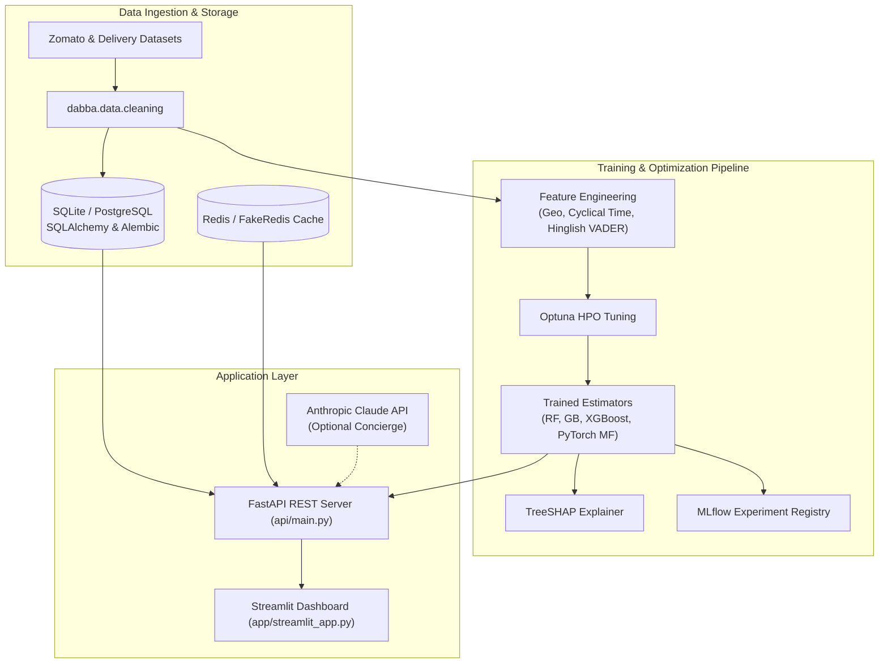

# Dabba

[](https://github.com/themanoj-025/Dabba/actions)
[](./LICENSE)
[](https://www.python.org/)
[](https://fastapi.tiangolo.com/)
[](https://mlflow.org/)
[](tests/)

India-focused restaurant ranking, recommendation, and delivery-reliability
platform combining deterministic gradient-boosted ML, PyTorch collaborative
filtering, VADER sentiment analysis, and optional Anthropic Claude LLM
explanations.

---

## Quick Facts

| Dimension | Details |
| --- | --- |
| **Domain** | Food-Tech Intelligence, Restaurant Ranking & Delivery ETA |
| **Core Architecture** | Modular ML pipeline + FastAPI v5 + Streamlit dashboard |
| **Primary Models** | RandomForest (Rating), GradientBoosting / XGBoost (ETA), PyTorch MF |
| **NLP & Sentiment** | VADER sentiment scoring tuned for Indian culinary reviews & Hinglish |
| **API Endpoints** | FastAPI REST API (`/health`, `/metrics`, `/v1/recommend`, `/v1/predict-eta`, `/v1/chat`, `/v1/explain/{id}`) |
| **Observability** | Structured JSON logging, Prometheus metrics, MLflow tracking, KS-test drift detection |
| **Test Coverage** | 364 collected tests across 28 unit and integration suites |
| **License** | [MIT License](./LICENSE) |

---

## Table of Contents

- [What It Does](#what-it-does)
- [Screenshots](#screenshots)
- [Key Features](#key-features)
- [Architecture](#architecture)
- [Tech Stack](#tech-stack)
- [Prerequisites](#prerequisites)
- [Quick Start](#quick-start)
- [Configuration](#configuration)
- [Project Structure](#project-structure)
- [API Reference](#api-reference)
- [Testing](#testing)
- [Limitations](#limitations)
- [Contributing](#contributing)
- [Security](#security)
- [License](#license)

---

## What It Does

India's food-tech ecosystem produces vast amounts of transactional, catalog,
and review data across delivery aggregators. However, consumers and operators
lack a unified platform that simultaneously accounts for culinary quality,
sentiment nuance, and transit reliability.

**Dabba** bridges this gap:
1. **Restaurant Ranking:** Evaluates catalog signals, cuisine variety, pricing,
   and Bayesian averages to generate objective quality ratings.
2. **Delivery ETA Prediction:** Models transit durations with uncertainty intervals
   using distance, historical rush-hour patterns, and external traffic APIs.
3. **Proprietary Reliability Index:** Computes a composite metric:
   `0.4 × norm(rating) + 0.3 × norm(sentiment) - 0.3 × norm(delay_risk)`.
4. **Hybrid Recommendations:** Combines PyTorch matrix factorization with
   content-based feature similarity and FAISS vector retrieval.
5. **Explainability & Concierge:** Exposes precomputed TreeSHAP feature attributions
   and provides an optional conversational AI concierge via Anthropic Claude.

---

## Screenshots

<!-- TODO[L2-01]: Capture dashboard visuals from running Streamlit instance -->
> *Interactive restaurant ranking, delivery ETA confidence intervals, and food concierge chat interface.*

---

## Key Features

- **Deterministic Core:** The ranking, ETA regression, and recommendation
  engines are 100% reproducible and operate offline without third-party API keys.
- **Ensemble Model Selection:** Automated benchmarking across scikit-learn,
  XGBoost, LightGBM, and CatBoost with Optuna hyperparameter optimization.
- **Hinglish Sentiment Analysis:** Specialized lexicon preprocessing for
  Indian food-tech reviews capturing colloquial praise and delivery complaints.
- **Production-Grade API:** FastAPI service featuring JWT/API-key authentication,
  SlowAPI rate limiting, circuit breaker protection, and Prometheus `/metrics`.
- **Drift Monitoring:** Kolmogorov-Smirnov (KS) two-sample statistical tests on
  production features with automated Slack alerting webhooks.

---

## Architecture



### Architectural Highlights

- **`src/dabba/`**: Clean library architecture decoupling feature extraction,
  database access, training pipelines, and observability.
- **State-Managed FastAPI**: Model weights and caches load during application
  lifespan into `app.state` and inject through FastAPI `Depends()`.
- **Fail-Safe Caching**: Redis client seamlessly degrades to in-memory `fakeredis`
  if external cache instances are unreachable.

---

## Tech Stack

| Layer | Component | Version | Purpose |
| --- | --- | --- | --- |
| **Runtime** | Python | `>=3.12` | Modern typed Python runtime |
| **Framework** | FastAPI | `>=0.143.0` | High-performance async REST API |
| **UI** | Streamlit | `>=1.64.0` | Real-time analytics and discovery UI |
| **Tabular ML** | scikit-learn, XGBoost, LightGBM, CatBoost | Latest | Ensembled regression and ranking |
| **Deep Learning** | PyTorch | `>=2.14.0` | Matrix factorization collaborative filter |
| **Vector Search** | FAISS CPU | `>=1.15.0` | Dense restaurant vector similarity search |
| **NLP** | NLTK (VADER) | `>=3.10.0` | Lexicon sentiment analysis |
| **Database** | SQLAlchemy & Alembic | `>=2.0` | Schema migrations and ORM |
| **Tuning & Tracking** | Optuna & MLflow | Latest | HPO search and artifact registry |

---

## Prerequisites

- **Python 3.12+**
- **uv** (recommended) or standard `pip`
- **SQLite3** (default local storage) or **PostgreSQL**
- Optional: **Anthropic API Key** (for food concierge chat)
- Optional: **Redis** (for production caching)

---

## Quick Start

### 1. Clone & Set Up Environment

```bash
git clone https://github.com/themanoj-025/Dabba.git
cd Dabba
```

#### Windows (PowerShell)

```powershell
python -m venv .venv
.venv\Scripts\Activate.ps1
pip install -r requirements.txt
Copy-Item .env.example .env
```

#### Linux / macOS

```bash
python3 -m venv .venv
source .venv/bin/activate
pip install -r requirements.txt
cp .env.example .env
```

### 2. Run the Full ML Pipeline (Optional)

Train model artifacts and populate SQLite tables:

```bash
python -m dabba.pipeline
```

### 3. Launch the FastAPI Backend

```bash
uvicorn api.main:app --host 0.0.0.0 --port 8000 --reload
```

*Expected output:*
```text
INFO:     Started server process
INFO:     Waiting for application startup.
INFO:     Dabba database initialized successfully.
INFO:     Application startup complete.
INFO:     Uvicorn running on http://0.0.0.0:8000 (Press CTRL+C to quit)
```

Interactive OpenAPI docs will be available at [http://localhost:8000/docs](http://localhost:8000/docs).

### 4. Launch the Streamlit Dashboard

In a separate terminal:

```bash
streamlit run app/streamlit_app.py
```

---

## Configuration

All configuration parameters use the `DABBA_` environment variable prefix
and are validated at runtime via `pydantic-settings`:

| Variable | Default | Secret? | Description |
| --- | --- | --- | --- |
| `DABBA_DATABASE_URL` | `sqlite:///data/dabba.db` | No | SQLite or PostgreSQL connection URI |
| `DABBA_REDIS_URL` | `redis://localhost:6379/0` | No | Redis caching host (auto-fallback to fakeredis) |
| `DABBA_API_KEY` | `change-me-to-a-random-secret` | Yes | Bearer key for protected backend endpoints |
| `DABBA_ANTHROPIC_API_KEY` | `""` | Yes | Anthropic Claude API key for conversational agent |
| `DABBA_LLM_ENABLED` | `false` | No | Toggle to activate conversational concierge router |
| `DABBA_MLFLOW_TRACKING_URI` | `http://localhost:5000` | No | Target MLflow tracking and artifact server |
| `DABBA_TOMTOM_API_KEY` | `""` | Yes | Real-time traffic API key (falls back to simulation) |
| `DABBA_MAPPLS_API_KEY` | `""` | Yes | India-specific mapping API key |
| `DABBA_SLACK_WEBHOOK_URL` | `""` | Yes | Incoming webhook for KS-test drift alerts |
| `DABBA_OPTUNA_ENABLED` | `true` | No | Enable hyperparameter optimization during training |

---

## Project Structure

```text
Dabba/
├── api/                        # FastAPI REST service
│   ├── auth.py                 # API key verification dependencies
│   ├── health.py               # Liveness and readiness endpoints
│   ├── limiter.py              # SlowAPI rate limiting configuration
│   ├── main.py                 # Application factory and route registration
│   ├── routers/                # recommend, eta, chat, explain, restaurants
│   └── schemas.py              # Pydantic request and response schemas
├── app/                        # Streamlit web application
│   ├── components/             # Reusable UI widgets
│   ├── pages/                  # Multipage dashboard views
│   └── streamlit_app.py        # Dashboard main entrypoint
├── src/dabba/                  # Core domain logic
│   ├── config.py               # Pydantic-settings centralized config
│   ├── data/                   # Data loaders and cleaning transformers
│   ├── database/               # SQLAlchemy models and session handling
│   ├── evaluation/             # Business cost and metric evaluators
│   ├── features/               # Feature engineering (spatial, cyclical)
│   ├── llm/                    # Anthropic Claude client and fallback narrators
│   ├── models/                 # Model builders, training, and registry
│   ├── monitoring/             # Drift detection and Prometheus metrics
│   ├── nlp/                    # Hinglish-aware VADER sentiment scoring
│   ├── observability/          # Structured JSON logging and tracing
│   └── pipeline.py             # End-to-end training and artifact generation
├── tests/                      # Pytest suite (364 unit and integration tests)
├── .env.example                # Sample environment template
├── docker-compose.yml          # Container orchestration (API, UI, Redis)
├── Dockerfile                  # Multi-stage production container build
├── pyproject.toml              # Project dependencies and tool settings
└── README.md
```

---

## API Reference

| Method | Endpoint | Auth | Description |
| --- | --- | --- | --- |
| `GET` | `/health` | Public | System liveness, database connectivity, and model statuses |
| `GET` | `/metrics` | Public | Prometheus scraping endpoint for request latency and counters |
| `POST` | `/v1/recommend` | API Key | Top-N hybrid recommendations matching budget and preferences |
| `POST` | `/v1/predict-eta` | API Key | Predict transit ETA with calibrated confidence bounds |
| `POST` | `/v1/chat` | API Key | Food concierge chat assistance (requires Anthropic key) |
| `GET` | `/v1/explain/{id}` | API Key | Fetch historical prediction with stored TreeSHAP values |
| `GET` | `/v1/model-info` | API Key | Introspect deployed model versions, features, and metrics |

---

## Testing

The test suite includes 364 tests across 28 modules verifying data cleaning,
model training, recommendation logic, API endpoints, and caching behavior.

```bash
# Run the complete test suite
pytest tests/ -v -o addopts=""

# Run with test coverage
pytest tests/ --cov=src/dabba -o addopts=""
```

All Redis interactions in tests automatically isolate using `fakeredis`,
and database interactions execute within temporary SQLite test sessions.

---

## Limitations

- **Synthesized Interaction Data:** Collaborative filtering models utilize
  synthesized user-restaurant interactions for demo seeding when live logs are absent.
- **Traffic API Fallbacks:** When external TomTom/Mappls API keys are not supplied,
  ETA predictions utilize deterministic time-of-day traffic simulations.
- **NLP Scope:** Sentiment extraction uses rule-based VADER adaptations for Hinglish;
  complex regional vernacular may require fine-tuned transformer models.

---

## Contributing

Contributions are welcome! Please follow these steps:

1. Fork the repository.
2. Create a feature branch: `git checkout -b feat/my-improvement`.
3. Format and lint code: `ruff check src/ tests/` and `black src/ tests/`.
4. Ensure all tests pass: `pytest tests/ -o addopts=""`.
5. Submit a pull request to `main`.

See [CONTRIBUTING.md](./CONTRIBUTING.md) for detailed guidelines.

---

## Security

Please report vulnerabilities privately via GitHub Security Advisories or
open an issue marked `security`. Never commit production secrets or real API
keys to source control. See [SECURITY.md](./SECURITY.md) for full policy.

---

## License

This project is licensed under the [MIT License](./LICENSE).
